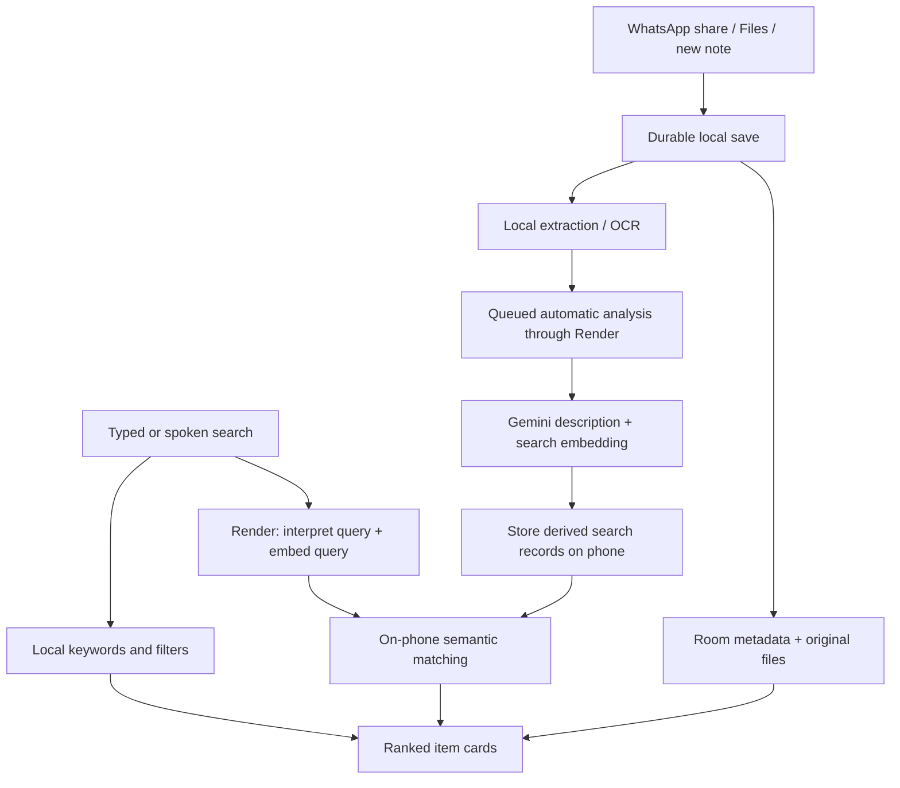

# Personal Library: product design and delivery roadmap

Date: 13 October 2026. Status: draft proposal for review. "Personal Library" is a working description, not a chosen product name.

This document specifies the proposed first version and its acceptance gates. It does not represent an implemented app, tested WhatsApp integration, deployed backend, or a detailed coding plan.

## 1. The product we are designing

Replace the owner's WhatsApp group, Random Links, with an Android app for saving and finding personal information: messages, grades, reminders, dates, photos, videos, stickers, links, audio, documents, archives, and arbitrary files.

The core loop is **save -> find -> use**. Success means capture takes little effort, originals remain available independently of WhatsApp, and retrieval works even when the owner remembers the meaning rather than the filename.

Confirmed requirements:

- Android first; English interface and English voice queries.
- Keep the authoritative collection and original files on the phone.
- Receive content through the Android share menu, especially from WhatsApp.
- Browse by type and filter or group by day, month, year, or all time.
- Search both directly and through Gemini-assisted natural language.
- The owner explicitly chose **automatic AI analysis of saved content**, rather than asking permission for each file.
- A small personal app, with features that directly support saving, organization, retrieval, and reuse.

Design assumptions: one owner, one primary phone, a privately distributed APK initially, and internet access for new Gemini requests. Cloud sync and multi-user accounts are outside V1. These assumptions can change during review without rebuilding the basic storage model.

## 2. Architecture decision

| Approach | Advantages for this project | Tradeoff | Recommendation |
| --- | --- | --- | --- |
| Kotlin + Jetpack Compose | Direct access to Android sharing, URI permissions, files, background work, media playback, speech, notifications, and accessibility | New native UI code rather than reusing SpendWise's React screens | Preferred for an Android app centered on files and media |
| React + Capacitor, following SpendWise | Familiar frontend stack and potential reuse of presentation patterns | Much of the critical storage, incoming sharing, and background pipeline still needs native integration | Reasonable if maximizing existing web code reuse becomes the priority |
| Flutter | A shared UI if iOS becomes a near-term requirement | Adds a new stack and still needs platform work; no existing Flutter code to reuse here | Reconsider only with a concrete cross-platform requirement |

This is an engineering judgment about this app's needs, not a claim that native development is always faster. Android's current recommendations support Compose, ViewModels, repositories, and coroutines; they also explicitly allow adapting the architecture to the size of the app. [Android architecture recommendations](https://developer.android.com/topic/architecture/recommendations).

Recommended stack:

- Kotlin, Compose, Material 3, screen ViewModels, coroutines and Flow.
- Room/SQLite for metadata and full-text search; files stored as files, not database blobs.
- WorkManager for durable indexing and AI queues after originals have been safely copied.
- Bundled ML Kit Latin-script OCR for offline text extraction from screenshots and images.
- Android media decoders and Media3 for supported audio/video; a maintained image loader for thumbnails and animation.
- Android document/photo pickers and FileProvider for explicit import, export, and sharing.
- Android speech recognition, preferring an available on-device English recognizer.
- A small Node/TypeScript service on Render, using Google's supported Gemini SDK.

Keep one Android app module initially with clear packages for capture, library, search, collections, reminders, storage, and AI. Use small interfaces around platform and network boundaries. A multi-module framework or microservice architecture is unnecessary for V1.

Proposed minimum Android version: Android 10 / API 29. Target the current stable SDK when building. Confirm the owner's phone model and OS before locking the compatibility matrix; offline speech capability must be checked separately.

### What we can borrow from SpendWise

The source inspected on 13 October 2026 was the clean local `main` checkout at `16ea687`. This was source inspection, not a live provider or deployment test.

- `package.json` and `capacitor.config.json` establish that SpendWise uses React/Capacitor rather than a Kotlin UI.
- `server/services/GeminiService.ts` provides a reusable design for server-held keys, structured JSON results, validation, cancellation, and bounded provider calls.
- `server/geminiReliability.ts` and `src/security/AuthenticatedApiClient.ts` provide reference patterns for deadlines, recovery, and safe failures.
- `server/config.ts` already defaults to `gemini-3.8-flash` and requires durable auth storage for Render.
- Installation authentication uses durable device identities and revocation concepts worth carrying across.

Reuse the contracts and relevant tested code after reviewing dependencies and app-specific assumptions. Give the new app its own backend service/configuration and enrollment boundary. Do not couple its file processing workload to SpendWise's production endpoints.

## 3. Organization and UX evidence

Use three complementary ways to find the same item:

1. **Automatic type sections:** Photos, Stickers, Videos, Text, Links, Audio, Documents, and Other Files.
2. **Optional collections:** owner-named, folder-like groups such as University, Grades, Important, Projects, or Memes.
3. **One search experience:** keywords, dates and filters, plus an explicit natural-language AI action.

Collections are logical memberships, not physical directories. A screenshot can appear in Photos, University, and Favorites while consuming space for one original. Removing a collection membership does not delete the item. Deleting a collection offers to remove the collection itself, with deletion of its contents treated as a separate explicit action.

The recommendation is informed by evidence, with limits:

| Evidence | Finding relevant here | Proposed application |
| --- | --- | --- |
| Bergman et al., 2013: two studies, 75 Gmail participants and 23 Windows participants | Participants preferred folders over tags; tag retrieval performed worse in the controlled task | Offer recognizable collections; do not require a manual tagging system. [Original study](https://onlinelibrary.wiley.com/doi/10.1002/asi.22906) |
| Gozali et al., 2012: exploratory study of 23 students and 8,096 photos | Meaningful photo groupings and chronological chapter order helped the studied tasks | Preserve chronology and support owner-controlled event or topic collections. [Authors' paper](https://www.comp.nus.edu.sg/~kanmy/papers/trc412-gozali.pdf) |
| Recognition over recall | Visible cues help people identify something without remembering its exact label | Show thumbnails, short previews, dates, recent items, and highlighted matches. [NN/g explanation](https://www.nngroup.com/articles/recognition-and-recall/) |
| Progressive disclosure | Secondary controls can be deferred while common actions stay visible | Make Save, Search, Open, and Share obvious; put extraction details, backup options, and advanced filters in secondary screens. [NN/g guidance](https://www.nngroup.com/articles/progressive-disclosure/) |

The two studies concern older desktop/email/photo environments; they do not prove this exact mobile layout is optimal. The latter two references are design guidance, not experiments on this app. The proposed hybrid and its particular screen layout are design inferences that must be tested with the owner.

## 4. Screen structure and interaction design

Use three labeled bottom destinations: **Library**, **Collections**, **Search**. Settings is an action in the top app bar. A labeled Add button creates a note or imports files.

### Library

- A prominent search field with a microphone action; it opens the same Search destination.
- A horizontal type strip, starting with All, Photos, Stickers, and Text, with remaining types available by scrolling.
- Newest saved first by default, with clear day or month headers.
- A compact optional Favorites row; an Upcoming row appears only when reminders exist.
- A date filter offering This month, This year, All time, and a custom range with month/year selection.
- Grid presentation for Photos and Stickers; readable list cards for text and files. All Items uses a consistent mixed-content list with thumbnails.
- A view toggle and ascending/descending date sort; preserve position when returning from an item.

Keep filtering and grouping distinct: "October 2026" limits the results; "Group by month" changes their presentation. Sorting by Saved date is the default. Original/source date is a separately labeled option when reliable metadata exists.

### Collections

Simple named cards with an icon or cover and item count. Provide Favorites, Unfiled, and Due as computed views. User collections are flat in V1; a deep folder hierarchy can wait for a demonstrated need. Suggestions from AI never silently move an item into a different owner collection.

### Search

Typing gives local results immediately. Tapping **Ask AI** or submitting a voice query triggers the assisted search. Ordinary typing must not incur a Gemini request for every keystroke.

Results remain familiar item cards, with thumbnails and a short explanation such as "Matched text in this screenshot" or "AI description mentions a timetable." Show applied filters as removable chips. Keep the search field and current query visible while refining a result.

No separate chatbot screen is needed. Follow-ups such as "only the ones from last month" can refine the current search without turning the product into a general assistant.

### Item details

The main preview comes first. Provide Open, Share, Favorite, Edit title/note, Add to collection, and Remind me. Secondary details expose original filename, size, saved/source dates, extracted text, AI description, and analysis coverage. Allow copying recognized text from screenshots.

Use system light/dark themes, one restrained accent color, legible type, labeled controls, clear selection states, and meaningful empty states. Support large font sizes, TalkBack, reduced motion, and adequate touch targets. Compose's accessibility guidance includes 48 dp targets. [Compose accessibility defaults](https://developer.android.com/develop/ui/compose/accessibility/api-defaults).

## 5. Saving from WhatsApp and other apps

Normal capture flow:

**WhatsApp -> select supported content -> Share -> Personal Library -> preview -> Save.**

The preview defaults to Unfiled and shows the incoming content. Title, note, and collection are optional. A batch uses a single Save action. After the original has been durably copied, show Saved and allow returning to the previous app; AI work continues separately.

Support `ACTION_SEND`, `ACTION_SEND_MULTIPLE`, text, captions, content URIs, and ClipData, including mixed batches where available. Android documents both single and multiple sharing, recommends preview/edit confirmation, and warns receivers to validate MIME types and large payloads. [Receive data from other apps](https://developer.android.com/develop/ui/compose/sharing/receive).

Important boundaries:

- Receive what WhatsApp actually exposes. Plain text may require **Copy -> Paste** if its current UI does not provide external Share for that selection.
- A shared media file may omit the original message's sender, chat, caption, or timestamp. Preserve what is supplied; do not invent provenance.
- If WhatsApp has already compressed a photo/video, the app stores that supplied version. It cannot reconstruct the sender's original.
- Do not depend on reading WhatsApp's private database or accessing its entire storage tree.
- Protected or unavailable content is reported as unavailable rather than silently skipped or bypassed.

### Stickers

Preserve WebP originals, transparency, and supported animation. WhatsApp's official sticker project specifies WebP and a distinct sticker-pack integration. [WhatsApp sticker documentation](https://github.com/WhatsApp/stickers/tree/main/Android).

Being able to decode a sticker does not prove that the installed WhatsApp version can share its raw file externally. Test that first. Where available, accept the file through sharing or an owner-selected file picker; otherwise explain the limitation. A screenshot fallback loses the original transparency or animation and must be labeled accordingly.

A WebP extension alone does not establish that an image is a sticker. Use any supplied metadata, cautious suggestions, and a manual **Mark as sticker** correction. V1 can share an image file back to other apps; sending it as a native WhatsApp sticker requires the separate pack integration proposed for V1.1.

## 6. V1 feature scope and format coverage

| Saved content | V1 viewing/use | Search coverage |
| --- | --- | --- |
| Text, grades, notes | Plain text, Unicode and emoji, editable title/note, copy and share | Full text, collections, dates, and meaning search |
| Links | Preserve URL and accompanying text; open in browser | URL, saved text, title/note, and meaning search; do not claim the whole webpage is archived |
| Photos and screenshots | Zoom, thumbnails, share original | Filename, local OCR, and automatically generated visual description |
| Stickers and GIFs | Transparent/animated preview where decoder supports it, favorites | Visible text and a generated description; animated analysis is bounded |
| Video | Thumbnail and native playback for supported codecs | Metadata, note, and description from sampled frames; audio and unsampled moments are outside baseline coverage |
| Audio and WhatsApp voice notes | Native playback for supported formats | Metadata/note; automatic transcription for supported short recordings |
| PDF | Preview with page navigation | Extractable text or OCR; long documents use incremental chunks with visible completion state |
| TXT, JSON, CSV and similar text files | Bounded plain-text preview; optional JSON formatting without changing the original | Decoded text up to a documented processing limit |
| DOCX, XLSX, PPTX and proprietary formats | Preserve file; open in an installed external app | Filename, note, collection and dates in baseline V1; internal document parsing is a later extension |
| ZIP and arbitrary binary files | Preserve original and export/open externally | Filename, extension, note, dates and collections; no promise to search all archived contents |

**Storage support is broader than preview support, which is broader than content understanding.** Unknown files are still useful archive items. Show whether an item has full text coverage, sampled/partial coverage, metadata-only coverage, or pending analysis. Do not equate "saved" with "fully understood."

Proposed initial automatic-processing budgets, to tune against the owner's sample collection before release:

- Images: an analysis copy with a maximum 1,600 px long edge; local OCR may use a separate resolution. Retry a selected hard-to-read image at higher detail within a bounded request.
- Video: up to six representative frames across the whole duration; mark results as sampled. No exhaustive scene or audio indexing in V1.
- Audio: automatically transcribe recordings up to five minutes; longer files remain playable and searchable by metadata until a later bounded transcription feature.
- PDFs: work in batches of up to ten pages, with an initial automatic ceiling of 100 pages per document and explicit partial coverage above that ceiling.
- Text-like files: initially process up to 1 MiB of decoded text; retain the complete original and disclose truncation.
- Provider payload limits override these defaults. Chunk large inputs and expose incomplete coverage instead of repeatedly failing.

These are proposed application limits, not claims about Gemini's maximum capabilities. File import itself has no arbitrary small quota: it streams files within available phone space and supported Android execution limits.

Additional V1 features:

- Favorites and batch add-to-collection, share, export, and delete.
- Exact binary duplicate detection; reuse the stored bytes while preserving separate notes or capture occurrences when useful. Do not automatically merge similar-looking photos or repeated reminders.
- A local reminder attached to any item, with a chosen date/time and optional snooze.
- Local notification permission requested when the owner first creates a reminder. Use Android's appropriate alarm APIs and permission flow; WorkManager is not an exact clock. Verify delivery after reboot and on the owner's OEM. [Android alarm guidance](https://developer.android.com/develop/background-work/services/alarms).
- AI may suggest a date from text; scheduling still requires an explicit owner action and editable date/time.
- Trash with Undo and a visible 30-day retention period; permanent deletion removes content and its search/index records.
- Storage usage split between originals, indexes, thumbnails, and trash. Clearing the thumbnail cache must not delete originals.
- Optional biometric/device-credential app lock. This is a UI access control in addition to Android storage protection, not a claim of a custom encrypted vault.

## 7. Local storage, ownership, and backup

Recommended V1 storage: app-managed persistent private files plus a Room database. It simplifies reliable capture and avoids requesting access to every file on the phone. Android documents that internal storage is permission-free for the app and that app-specific files are removed on uninstall. [App-specific storage](https://developer.android.com/training/data-storage/app-specific).

For each received file, immediately stream the granted URI into a staging file while access is valid. Never assume a temporary shared URI can be reopened by a later worker. Large imports need a visible, lifecycle-safe transfer path that complies with the target Android version's foreground execution rules.

Commit the library entry only once the file is complete. Use a recoverable import state machine to reconcile files and database records after process death; a file rename and a database transaction are not one atomic cross-system transaction. Indexing begins from the managed copy.

Saving makes an independent copy. Deleting the WhatsApp source later does not remove the app's copy; keeping both uses space in both apps. No source cleanup is automatic.

There is no permanent content database on Render. Durable server data is limited to necessary enrollment/authentication, revocation, and usage-limit state. Android's OS storage encryption is the baseline; do not label this as app-level end-to-end encryption.

### Backup and portability are release requirements

- Export individual originals to an owner-selected destination.
- Export a complete, versioned backup containing original files, item text, titles, notes, source/saved dates, collection memberships, favorites, reminders, and a manifest with hashes.
- Make the default complete backup passphrase-encrypted using a maintained authenticated-encryption library and documented format. Do not design a new cipher or make the only restore key device-bound.
- Include locally generated descriptions/embeddings when practical, or explicitly identify the indexes that will be regenerated. Local keyword search must still work after restore without Gemini.
- Restore into staging, validate format/hash integrity, preview counts and duplicate choices, then commit. A failed restore must not damage the existing library.
- Export via Android's file picker to phone storage, a removable drive, or a document provider the owner chooses. Choosing a cloud document provider is an explicit backup destination, not automatic cloud sync. [Storage Access Framework](https://developer.android.com/training/data-storage/shared/documents-files).
- Show Last successful backup and a contextual backup reminder. A backup on the same phone protects against accidental removal but not losing the phone; offer an external destination.
- Configure Android backup/device-transfer rules deliberately. Do not rely on platform Auto Backup for a media library; its documented per-app cloud allowance is 25 MB. [Android Auto Backup](https://developer.android.com/identity/data/autobackup).

Alternative considered: store everything in a user-selected public directory. That can make originals survive uninstall, but creates permission, external edit/deletion, and metadata-consistency problems. Prefer managed storage plus tested backup in V1; an optional external library location can be designed later if the owner prioritizes direct filesystem access.

## 8. How Gemini search actually works

Gemini does not directly connect to the phone's private database. The app controls what is analyzed and executes all retrieval locally.

### At save time

1. Save locally and make the item available immediately.
2. Extract text and metadata, including bundled local OCR. A bundled Latin OCR model avoids waiting for a first-use model download. [ML Kit Android OCR](https://developers.google.com/ml-kit/vision/text-recognition/v2/android).
3. Queue supported content for automatic cloud analysis. Send an image analysis copy, document text/page batches, sampled frames, or supported short audio through Render. Remove unnecessary location metadata from analysis copies; preserve originals.
4. Generate a concise description, searchable concepts, and validated optional date/title suggestions. Machine descriptions remain separate from owner-written notes.
5. Create a search embedding of each indexed text chunk, including useful visual descriptions; store it on the phone alongside source item/page references.

The index uses Room full-text search for literal matches and a small local vector index for meaning. Google provides embedding models and retrieval-oriented usage guidance, separate from the Flash model used to describe and interpret content. [Gemini embeddings](https://ai.google.dev/gemini-api/docs/embeddings), [Room full-text support](https://developer.android.com/training/data-storage/room/defining-data).

Start with 768-dimensional normalized text embeddings and a simple local similarity scan. At 10,000 chunks, float32 vectors occupy about 29.3 MiB before database/index overhead. Benchmark actual memory and latency; chunk count can exceed item count. Add a more elaborate nearest-neighbor index only if measurements justify it. Embedding model, dimension, and preprocessing version must be stored, and incompatible model changes require reindexing.

This text-first embedding design keeps V1 maintainable. Direct multimodal embeddings may improve particular photo searches later, after comparison on the owner's retrieval examples.

### At search time

Example: "Find the screenshot of my chemistry grades that I saved last month."

1. Local keyword search immediately returns what it can.
2. The AI request contains the query, the phone's current date/timezone, and the minimum necessary collection vocabulary. It returns a validated search plan: concepts, requested types, and explicit date ranges.
3. Generate a query embedding through the proxy. Search indexed chunks on the phone; combine semantic and literal matches with the requested filters. Do not use a narrow keyword shortlist as the only input to semantic search.
4. Display actual saved item IDs with previews and match explanations. Optional reranking can send a bounded set of candidate excerpts, not the full library.
5. Resolve "last month" against the chosen date basis and display the filter so the owner can correct it.

Any answer such as "your chemistry grade was ..." must link to the actual saved source, preferably its page or image region. Search results are the V1 priority; a general conversational assistant is unnecessary.

Coverage and correctness rules:

- Literal filenames, numbers, and grades need full-text matching as well as semantic similarity.
- AI cannot find a scene that was neither sampled nor described, or inspect an unsupported archive simply because it is stored.
- Show Not analyzed yet / Partially analyzed / Metadata only where appropriate.
- Exclude trash and deleted items from normal results. An item excluded from AI remains available to local keyword search, but must not be uploaded for analysis, query context, or reranking. Turning off AI does not erase prior provider processing. Item deletion invalidates both keyword and vector records.
- Treat saved text and documents as data, including any embedded instructions. The model receives no arbitrary SQL, file-deletion, or filesystem-execution tool.
- Validate structured output and returned IDs. AI suggestions cannot delete, rewrite originals, or silently reschedule reminders.

### Voice

The requested function is **speech-to-text**: speech becomes an editable English query, which enters the same search pipeline. Translation is unnecessary when speaking English. Text-to-speech would be optional read-back later.

Check for a usable on-device English recognizer; Android's explicit availability API is available from API 31. If absent, use an identified online recognition path with clear disclosure. Automatic content analysis consent does not silently authorize every microphone recording path. No always-listening service. [Android SpeechRecognizer](https://developer.android.com/reference/android/speech/SpeechRecognizer).

Keyword search, browsing, OCR, and previously downloaded descriptions work offline. New cloud interpretation, cloud embeddings, and online speech do not. Previously analyzed content being local does not make every new semantic query fully offline.

## 9. Backend, privacy, reliability, and operating cost

Your automatic-analysis choice is the proposed default. Provide simple controls for Pause AI, Wi-Fi-only background analysis, mobile-data allowance, and excluding an item or collection. Respect exclusions before upload; explain that turning analysis off cannot recall content already processed by a provider.

The app's description must distinguish **local storage** from **cloud processing**. Supported content is transmitted to Render and Google for analysis; the authoritative library stays on the phone. Render should not retain content in application logs, server files, or a permanent search index. Provider retention is governed by Google's terms, not by our application settings.

For a personal archive, use a billing-enabled Gemini API project: Google's paid-service terms say prompts/responses are not used to improve its products, while the unpaid terms allow such use and human review and advise against submitting personal or sensitive content. Paid services still allow limited safety/abuse logging. [Gemini API terms](https://ai.google.dev/gemini-api/terms).

Backend responsibilities:

- Keep the Gemini key only in server secrets. Never put it or a permanent shared owner credential in an APK. [Gemini key guidance](https://ai.google.dev/gemini-api/docs/api-key).
- Owner-controlled device pairing/enrollment, Android Keystore identity, short-lived authenticated requests, and revocation.
- A small durable auth/quota store; no open unlimited endpoint and no assumption that a freely registrable device is the owner.
- Strict request sizes and schemas, per-device limits, bounded concurrency, and cancellation/deadlines that cover upload and response receipt as well as provider inference.
- Safe retries with backoff and quota distinction; no unlimited retry loops or repeated uploads after a permanent failure.
- Sanitized operational logs containing duration, status, and usage counters; exclude filenames, contents, transcripts, prompts, credentials, and tokens.
- Keep the durable work queue on the phone. A process restart on Render must not lose knowledge of pending library items.

Background processing defaults to Wi-Fi and battery-not-low, with small bounded batches and foreground searches prioritized. Reanalyze only when content, owner metadata affecting retrieval, or index version changes. A user-requested Retry remains available after a clear error.

Model decision: Google currently marks `gemini-3.5-flash` deprecated and automatically routes it to `gemini-3.6-flash`. Its catalog lists `gemini-3.8-flash` as stable, and the inspected SpendWise config already uses it. Recommend testing 3.8 Flash for this app while keeping model selection server-configurable. Do not change models or mix embeddings without a retrieval-quality check. [Gemini 3.5 Flash status](https://ai.google.dev/gemini-api/docs/models/gemini-3.5-flash), [Current model catalog](https://ai.google.dev/gemini-api/docs/models).

Render Free can support a prototype but sleeps after 15 minutes idle and may take about a minute to wake. Its filesystem is ephemeral, and free Postgres expires after 30 days. Budget for durable auth storage; choose an always-on service if immediate AI response matters. Local saving and ordinary search must work while the backend wakes. [Render Free limitations](https://render.com/docs/free).

Costs come from backend hosting, durable auth storage, description/transcription calls, and embedding generation. A large first import is likely to cost more than ordinary daily additions. Measure a representative synthetic/sample batch before estimating monthly usage. Offer a count/usage summary and enforce server-side daily processing limits; treat billing alerts as alerts, not guaranteed hard spending caps. Check the selected models' live rates before enabling billing. [Gemini pricing](https://ai.google.dev/gemini-api/docs/pricing).

Use honest states: Saved locally, Waiting for Wi-Fi, Reading text, Analyzing, Ready, Partially analyzed, or Needs retry. Show progress counts when known, such as pages or files completed. Never make the save confirmation wait on Gemini or show invented percentages.

## 10. Data model and maintainability

The essential records are:

| Record | Purpose |
| --- | --- |
| Item | Title, owner note/text/URL, kind/subtype, saved date, optional source date and provenance, favorite/trash state |
| Asset | Managed file path, original filename, MIME/type verification, byte size, content hash, and file metadata |
| Collection + ItemCollection | Folder-like organization and membership without copying bytes |
| ImportBatch / capture occurrence | Connect related attachments and supplied captions; track partial failures and original capture context |
| SearchDocument | Extracted text/description chunks, origin/page reference, FTS entry, embedding and index version |
| AnalysisJob | Durable processing stage, item/content version, attempts, coverage, last safe error, and exclusion policy |
| Reminder | Linked item, due time/timezone behavior, scheduled state, and completion/snooze state |

Keep saved date, source/capture date, and reminder due date separate. Store instants consistently and derive month/year filters using the phone's relevant timezone. Date-only events should remain date-only rather than shift because of UTC conversion.

Repository boundaries: CaptureRepository, LibraryRepository, SearchRepository, CollectionRepository, ReminderScheduler, BackupService, and AiGateway. Platform details and the network SDK stay behind these boundaries. Database migrations must preserve assets and include index rebuild/version handling.

## 11. Bringing over Random Links

Make migration a first-release onboarding capability rather than leaving the old archive unusable.

1. Start with a small export/sample from Random Links to verify the actual Android WhatsApp format, dates, text encoding, attachment delivery, and missing-media markers.
2. Accept the owner-provided exported text plus the attachments WhatsApp supplies, whether separate or packaged. Preserve the raw export as a source record.
3. Preview parsed message and attachment counts; detect ambiguous day/month date formats rather than guessing. Preserve multiline messages, emoji, supplied sender information, and original message dates separately from import dates.
4. Match attachment references conservatively. Report unmatched and missing media, duplicate bytes, unsupported records, and parse failures. Do not count a missing attachment as successfully imported.
5. Place imported items in a Random Links collection, then queue bounded analysis. Allow normal use while indexing progresses.
6. Offer batch media import through the system picker for older content absent from the export. Re-exporting or re-importing should not blindly duplicate stored bytes.

WhatsApp's documented Android export includes a text file and, when selected, recent media attachments; that is not a guarantee of the entire historical media library. Export may also be unavailable when Advanced Chat Privacy is enabled. [WhatsApp export help](https://faq.whatsapp.com/1180414079177245/?cms_platform=android&locale=en_US), [Advanced Chat Privacy](https://faq.whatsapp.com/715385484388016/?cms_platform=android&locale=en_US).

Do not remove Random Links or its media as part of migration. Keep the source until counts, representative files, and a restored backup have been checked by the owner.

## 12. Delivery roadmap and acceptance gates

These are ordered work packages within the first release, not permission to start implementation or separate promised release dates.

| Stage | Deliverable | Gate before proceeding |
| --- | --- | --- |
| 0. Device feasibility | Minimal share/preview/import prototype; Random Links sample format; English speech check | On the owner's actual WhatsApp/Android combination, check text, photo, video, audio, document, static sticker, animated sticker, and multiple selection; establish a working path or clearly document the limitation and available fallback for each |
| 1. Durable capture and Library | Managed original files, recoverable imports, note/link creation, type views, previews | Saved items survive source deletion, force-stop and reboot; large/unknown files and low-storage failure leave no false success or corrupted entry |
| 2. Local retrieval and organization | Collections, favorites, date filters, Room search, bundled OCR, local reminders | Retrieve representative grades/text/screenshots offline; collection changes do not copy assets; date boundaries and reminder delivery are correct |
| 3. Backup and migration | Export/restore, integrity checks, trash, Random Links importer | Round-trip library and collection data on a fresh install; reject damaged/wrong-password backups safely; show import gaps accurately |
| 4. Gemini enrichment and retrieval | Separate authenticated Render proxy, automatic indexing queue, descriptions, embeddings, assisted search | Useful results against an agreed query set; originals unchanged; AI failures do not block saving; quotas, cancellation, exclusions, and incomplete coverage are visible |
| 5. Voice and release acceptance | Editable English voice search, accessibility/performance polish, signed private APK | Owner completes daily save/find/share tasks on the phone; backup is restored; TalkBack, large fonts, network loss and OEM background behavior receive focused checks |

Performance and usability targets to validate, not claims already achieved:

- A straightforward share requires at most one in-app Save tap after choosing the app; no mandatory naming or filing.
- Confirmation follows durable storage, not AI completion. Large-file duration scales with real transfer progress.
- Ordinary local search targets p95 below 300 ms over 10,000 indexed items on the reference phone, with realistic OCR text and chunk counts.
- Use 20-30 owner-like retrieval queries with known target items. Target the correct item in the top five for at least 90% of the supported, fully indexed cases; report exact/semantic/visual categories separately and do not hide misses behind the average.
- In a short owner task test, retrieve at least 8 of 10 representative items within 15 seconds each without needing exact filenames.
- Tests cover interrupted imports, transient URI access, duplicate handling, missing attachments, stale AI responses, deletion/index consistency, incompatible embedding versions, date boundaries, quota exhaustion, malformed files, and backup recovery.
- Automated CI and emulator evidence are separate from actual WhatsApp, provider, and physical-phone acceptance.

Before implementation, review this product specification, resolve any owner corrections, and then produce a task-level engineering plan with dependency versions and the device test matrix.

## 13. Small extensions after the first release

Prioritize only observed needs:

- Native WhatsApp sticker-pack export, if saving and reusing stickers proves important.
- Saved searches and lightweight home-screen shortcuts.
- Related saved items using the existing local semantic index.
- Longer audio transcription and deeper video search, with explicit processing and cost limits.
- Office document text extraction and safe archive entry indexing.
- A local query-embedding model if fully offline semantic search becomes important.
- Optional user-selected external library storage or an explicit automated backup destination.

Defer public accounts, collaboration, social feeds, multi-device sync, a general chatbot, automatic file deletion, full document editing, an always-listening assistant, and autonomous calendar/task management. Each would add maintenance without being necessary to replace Random Links.

The first release is complete only when the owner can confidently save, find, reuse, back up, and restore a representative personal library on the actual phone.
